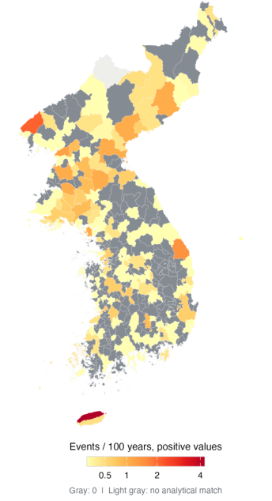

# Joseon Silok Events Dataset
A two-model consensus dataset of historical events extracted from the Veritable Records of the Joseon Dynasty (1392–1863), comprising 12,745 article–event–place records across 20 categories.

## Example Visualization

### Spatial Distribution of Relief Events

The following map illustrates the geographic distribution of relief-related events extracted from the *Veritable Records of the Joseon Dynasty*.

  

**Figure 1. Spatial distribution of recorded relief events.**

